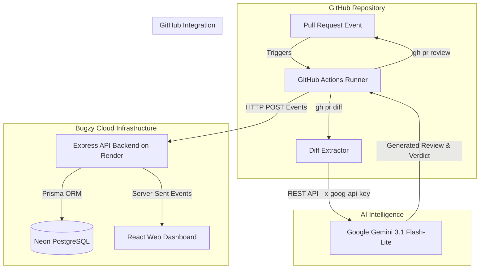

# 🐞 Bugzy — AI-Powered Code Review Assistant

Bugzy is an automated code review platform that integrates **Google Gemini AI** into GitHub Pull Request workflows. When a developer opens or updates a Pull Request, Bugzy analyzes the code diff for logic errors, security vulnerabilities, performance bottlenecks, and code quality issues—automatically posting detailed feedback and verdicts directly back to GitHub while streaming live review progress to an interactive web dashboard.

---

## 📚 Table of Contents

- [Project Overview](#-project-overview)
- [System Architecture](#-system-architecture)
- [Features Implemented](#-features-implemented)
- [Technology Stack & Folder Structure](#-technology-stack--folder-structure)
- [API Reference](#-api-reference)
- [Local Setup & Configuration](#-local-setup--configuration)
- [GitHub Actions Workflow Setup](#-github-actions-workflow-setup)
- [Deployment Architecture](#-deployment-architecture)
- [Known Limitations & Future Work](#-known-limitations--future-work)

---

## 🎯 Project Overview

Bugzy simplifies code quality enforcement by combining automated AI code reviews with real-time monitoring:

1. **Automated AI Code Reviews**: Every Pull Request is automatically evaluated for correctness, potential bugs, edge cases, security flaws, and maintainability.
2. **Actionable PR Verdicts**: Reviews return an explicit verdict—`APPROVE`, `REQUEST_CHANGES`, or `COMMENT`—and automatically post structured Markdown feedback onto GitHub.
3. **Live Dashboard**: A modern React web dashboard displays live review progress, step-by-step logs, verdict stats, and historical review reports streamed in real-time via Server-Sent Events (SSE).

---

## 🏗️ System Architecture

Bugzy consists of four decoupled layers working together:



### Data Flow Overview
1. **Trigger**: A GitHub PR event (`opened`, `synchronize`, `reopened`) launches `.github/workflows/pr-review.yaml`.
2. **Registration**: The workflow registers the job with the Bugzy backend (`POST /api/reviews/start`).
3. **Analysis**: The runner extracts code diffs (capped safely at 30,000 characters) and sends a prompt to Google Gemini 3.1 Flash-Lite.
4. **GitHub Feedback**: The parsed review and verdict are submitted back to the GitHub PR using `gh pr review`.
5. **Dashboard Sync**: Step events and completion payloads (`POST /api/reviews/:id/complete`) update the PostgreSQL database and stream live to connected browser dashboards over SSE (`GET /api/events`).

---

## ✨ Features Implemented

- ✅ **Automated GitHub Trigger**: Listens for PR updates and manual `workflow_dispatch` triggers.
- ✅ **Safe Diff Handling**: Truncates large pull request diffs safely in Bash to prevent `SIGPIPE` (exit code 141) under `pipefail`.
- ✅ **Google Gemini 3.1 Flash-Lite Integration**: Uses low-latency, high-volume AI model (`gemini-3.1-flash-lite`) authenticated via secure `x-goog-api-key` headers.
- ✅ **Automated Verdict Generation**: Parses AI output into distinct verdicts (`APPROVE`, `REQUEST_CHANGES`, `COMMENT`). Demonstrated in real PR testing yielding both `APPROVE` and `REQUEST_CHANGES` verdicts.
- ✅ **Real-time SSE Dashboard**: Live event feed using native `EventSource` with automatic reconnection handling.
- ✅ **Database Persistence**: Persistent history of reviews, step durations, and analysis reports powered by PostgreSQL and Prisma ORM.
- ✅ **Health Monitoring**: Self-healing API health checks (`GET /api/health`) that monitor database connection pooling.

---

## 🛠️ Technology Stack & Folder Structure

### Tech Stack
* **Frontend**: React 19, TypeScript, Vite, CSS Modules / Custom Properties
* **Backend**: Node.js, Express, `pg` (node-postgres), `@prisma/adapter-pg`
* **Database**: PostgreSQL, Prisma ORM
* **AI Provider**: Google Gemini API (`gemini-3.1-flash-lite`)
* **CI/CD & Automation**: GitHub Actions, GitHub CLI (`gh`)
* **Hosting**: Render (Web Service), Neon (PostgreSQL)

### Repository Structure
```
bugzy/
├── .github/
│   └── workflows/
│       └── pr-review.yaml       # GitHub Actions AI review workflow
├── docs/                        # Architecture & API documentation
├── prisma/
│   └── schema.prisma            # Root Prisma schema definition
├── public/                      # Static assets & icons
├── server/
│   ├── config/                  # Prisma configuration
│   ├── lib/
│   │   └── db.ts                # PostgreSQL connection pool & Prisma setup
│   ├── prisma/
│   │   └── schema.prisma        # Database models (Review, Event, Enums)
│   ├── index.ts                 # Express REST & SSE server
│   └── package.json             # Server dependencies & scripts
├── src/
│   ├── components/              # React components (ReviewCard, EventTimeline)
│   ├── hooks/                   # Custom hooks (useSSE, useReview, useReviewsAction)
│   ├── services/
│   │   └── api.ts               # Frontend API service layer
│   ├── App.tsx                  # Main dashboard application UI
│   ├── types.ts                 # TypeScript interfaces (PRReview, PREvent)
│   └── main.tsx                 # React entrypoint
├── .env                         # Root environment variables
├── package.json                 # Project dependencies & scripts
└── vite.config.ts               # Vite configuration
```

---

## 🔌 API Reference

The Express backend (`server/index.ts`) provides the following REST and SSE endpoints:

| Method | Endpoint | Description |
| :--- | :--- | :--- |
| `GET` | `/api/health` | Health status check; verifies PostgreSQL database connectivity. |
| `GET` | `/api/reviews` | Retrieves all historical PR reviews from PostgreSQL. |
| `GET` | `/api/reviews/:id` | Fetches details and timeline events for a specific review ID. |
| `GET` | `/api/events` | Server-Sent Events (SSE) stream for live dashboard updates. |
| `POST` | `/api/reviews/start` | Registers a new review job (`RUNNING` status) and returns a `reviewId`. |
| `POST` | `/api/reviews/:id/event` | Appends a step event or intermediate log to an active review. |
| `POST` | `/api/reviews/:id/complete` | Finalizes a review (`COMPLETED` or `FAILED`), saving the final report and verdict. |

---

## 💻 Local Setup & Configuration

### Prerequisites
- **Node.js**: v18.0.0 or higher
- **npm**: v9.0.0 or higher
- **PostgreSQL**: Local database instance or remote connection URL (e.g., Neon)

### 1. Clone & Install Dependencies
Run the setup script to install dependencies for both the root frontend and the Express backend:
```bash
git clone https://github.com/shafiankhan/bugzy.git
cd bugzy
npm run setup
```

### 2. Configure Environment Variables

Create or update `.env` in the root directory:
```env
VITE_API_URL=http://localhost:3001
```

Create `server/.env` in the `server/` directory:
```env
PORT=3001
DATABASE_URL="postgresql://<user>:<password>@localhost:5432/pr_reviews?schema=public"
```

> [!CAUTION]
> Never commit `.env` files, passwords, or secret keys to version control.

### 3. Initialize the Database Schema
Push the Prisma schema to your PostgreSQL database:
```bash
cd server
npx prisma db push
```

### 4. Run Development Servers
Start both the Express backend and Vite frontend concurrently:
```bash
# Run both servers from root directory
npm run dev:all

# Or run separately:
# Terminal 1 (Backend):
cd server && npm run dev

# Terminal 2 (Frontend):
npm run dev
```

Open `http://localhost:5173` in your browser to view the live dashboard.

---

## 🤖 GitHub Actions Workflow Setup

To enable automated AI code reviews on a target GitHub repository:

1. **Copy the Workflow**:
   Copy `.github/workflows/pr-review.yaml` into your target repository at `.github/workflows/pr-review.yaml`.

2. **Configure Repository Secrets**:
   Go to **Settings** → **Secrets and variables** → **Actions** in your GitHub repository and add:
   * `GEMINI_API_KEY`: Your Google Gemini API Key.
   * `DASHBOARD_API_URL`: Public HTTPS URL of your Bugzy backend (e.g., `https://bugzy-oein.onrender.com`).

3. **Enable Workflow Permissions**:
   Go to **Settings** → **Actions** → **General** → **Workflow permissions**:
   * Select **Read and write permissions**.
   * Check **Allow GitHub Actions to create and approve pull requests**.

4. **Trigger a Review**:
   Create a branch, make a code change, and submit a Pull Request. The workflow will run automatically, calling `gemini-3.1-flash-lite`, submitting PR review comments on GitHub, and streaming events to your dashboard.

---

## 🚀 Deployment Architecture

Bugzy uses a lightweight, cloud-hosted architecture:

* **Backend Service**: Hosted on **Render** (Node.js Web Service) running `npm start` (`tsx index.ts`).
* **Database**: Hosted on **Neon PostgreSQL** (serverless pooled connection).
* **Environment Variables (Render Dashboard)**:
  * `DATABASE_URL`: `postgresql://<user>:<password>@<neon-host>/neondb?sslmode=require`
* **Frontend**: Can be hosted on Vercel, Netlify, Render Static Site, or run locally pointing `VITE_API_URL` to the hosted Render backend.

---

## 🔮 Known Limitations & Future Work

### Current Limitations
- **Workflow Scope**: Automated code reviews are triggered via GitHub Actions (`pull_request`). GitLab CI/CD integration is not currently implemented.
- **Review Level**: Reviews are posted as top-level PR feedback bodies with markdown line references; inline line-by-line diff comments are currently in development.
- **Manual Dashboard Triggers**: The "Start Review" button on the web dashboard registers review jobs in the database, but full execution relies on the GitHub Actions workflow runner.

### Planned Features
- 🔄 GitLab Merge Request & GitLab CI integration.
- 📍 Inline diff commenting via GitHub Checks API.
- 🔐 User authentication & multi-tenant organization workspaces.
- ⚡ Webhook ingestion endpoint (`POST /api/webhooks/github`) for direct event handling.
